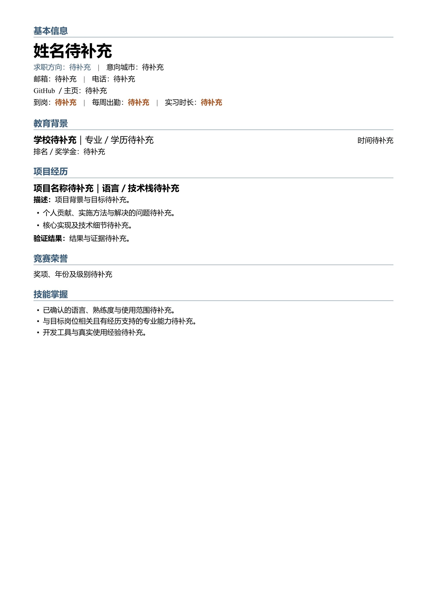

# Resume LaTeX Workflow

一个中文简历制作 skill：**分轮提问 → Markdown 大纲 → LaTeX/PDF → 岗位研究与润色 → 批注迭代**。适合从零制作简历，也支持已有简历的改写。默认单页蓝灰色排版，正文可选择、源码可编辑。

## 使用

将本仓库中的 `resume-latex-workflow` 文件夹放到 `~/.codex/skills/`，随后在支持 skills 的 Codex 会话中调用：

```text
使用 $resume-latex-workflow，帮我做一份分布式存储研发实习简历。
先分轮问我问题，再生成 Markdown 大纲，按模板制作 LaTeX 和 PDF。
结合我的真实经历研究岗位要求并润色。
```

其他起手方式：

```text
使用 $resume-latex-workflow，按我已有简历直接生成，缺失项标待补充。
使用 $resume-latex-workflow，按这些 PDF 批注修改现有 resume.tex。
```

安装后若当前客户端未刷新技能列表，可在新会话调用。其他支持文件型 skills 的工具可以读取 `SKILL.md`，但工具名称、编辑器和编译能力需由其环境提供。

## 工作流

1. **访谈**：按基本信息、个人介绍、教育、工作/实习、项目/校园、技能/证书分轮收集，每轮最多五问。已知信息不重复问，不清楚的内容最多追问两轮。
2. **大纲**：目标岗位用一级标题，模块用二级标题，每个字段单独列表项；默认不超过500字。完整正文单独保存，避免大纲字数限制挤掉项目证据。
3. **制作**：按随附模板生成 `resume.tex` 和 PDF，姓名与联系信息分组，照片在右，项目名称/语言突出，项目链接同行右对齐，竞赛在技能之前。
4. **研究润色**：按目标岗位和候选人资历查找招聘要求，优先官方来源，突出“做了什么、怎么做、结果如何”。不把职位要求或别人的成果写成候选人的经历。
5. **学习方向**：询问“想学但还没学什么”；跳过或不知道时，主动筛选2～3个相关方向并标“待学习”。用户明确不要时不添加。
6. **检查和修改**：先查事实与内容一致性，再编译和查看实际渲染；按PDF批注修改同一源码。用户说“直接生成”时不再继续访谈。

默认大纲包含基本信息、个人介绍、教育背景，至少五模块；用户明确删掉个人介绍时遵循用户选择。无经历不虚构，未知项标待补充。照片、预留第二项目空间、奖项级别和技能熟练度均以用户资料为准。

## 模板与运行环境

模板：[resume-template.tex](resume-latex-workflow/assets/resume-template.tex)。[空白模板 PDF](docs/template-preview.pdf)只演示版式，字段均为待补充。



已有原生 LaTeX 编辑器/编译工具时优先使用。否则本地需要 XeLaTeX，以及模板使用的标准宏包（fontspec、xeCJK、geometry、xcolor、graphicx、titlesec、enumitem、hyperref）。字体优先微软雅黑/Times New Roman，缺失时采用 Noto CJK/Fandol 和 TeX Gyre。没有编译器时保留源码并报告 PDF 未生成，不自动安装 TeX。

```sh
xelatex -interaction=nonstopmode -halt-on-error resume.tex
```

可选预览检查脚本需要 Python 3 和 PyMuPDF。它报告字体是否嵌入、可选择文字、页面外文字及链接，并生成约216dpi预览：

```sh
python resume-latex-workflow/scripts/inspect_pdf.py resume.pdf --output preview
```

自动检查不能替代事实核对或逐页视觉检查。网页研究需要可用浏览工具；浏览不可用时保留现有事实，明确说明研究未完成，不能编造来源。

## 文件结构

```text
resume-latex-workflow/
  SKILL.md
  agents/openai.yaml
  assets/resume-template.tex
  references/layout.md
  references/research-writing.md
  scripts/inspect_pdf.py
```

使用时产生的 `facts.md`、`resume-content.md`、真实头像和候选人文件应留在个人工作区，不提交到本公共仓库。验证记录见 [审核记录](docs/QUALITY.md)。

版式参数来自实际简历迭代，曾参考 [Auto-CV](https://github.com/flamingoTOM/Auto-CV) 的组织方式；随附模板用标准 article 独立实现，不需要第三方 resume.cls。代码与说明采用 MIT License。第三方工具、字体的许可由各自提供方决定。
